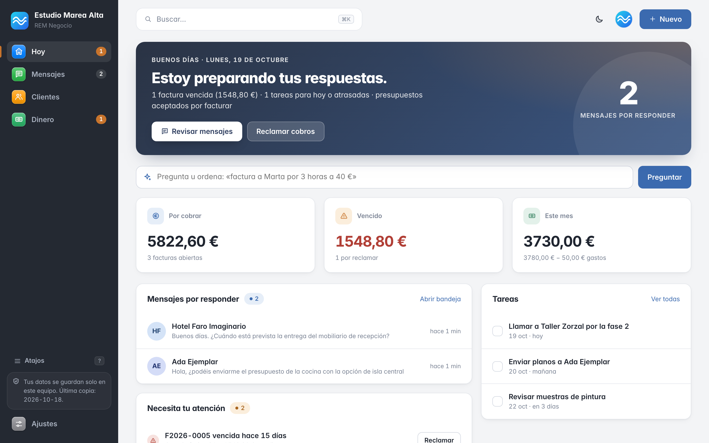

# REM Negocio

**Español** · [English](README.en.md)

   

**La gestión diaria de una pyme o un autónomo, en su propio ordenador.** Clientes, presupuestos, cobros, gastos, tareas y mensajes de clientes en una sola pantalla, con un asistente de IA local que prepara borradores y nunca envía nada por su cuenta.

## Por qué REM

- **Tus datos se quedan en tu equipo.** Sin cuentas, sin nube y sin telemetría. Base de datos local con copia diaria y copias cifradas.
- **Sabes qué hacer hoy.** Qué cobrar, qué está vencido, qué presupuestos esperan respuesta y qué mensajes faltan por contestar.
- **IA que propone, no que actúa.** Un modelo local (Ollama) redacta respuestas y recordatorios de pago con los datos de tu negocio. **Aprobar no es enviar:** nada sale sin tu clic, ni siquiera ante mensajes que intentan engañar al asistente.
- **Cierre limpio para tu asesor.** IVA por trimestre, cifras orientativas de los modelos 130/303/115/347 y exportación a CSV y Excel.
- **Libre y sin dependencias.** Licencia MIT; solo necesita Node.js.

## Qué no es

> **REM no es un programa de facturación conforme con Verifactu.** La normativa se aplica a los programas con los que se expiden facturas, aunque no envíen nada a Hacienda. Emite tus facturas oficiales en un programa conforme y usa REM para preparar, controlar, cobrar y entregar el cierre. Detalle y fuentes oficiales: [Marco legal](docs/marco-legal.md).

Tampoco presenta impuestos, ni es multiusuario, ni está pensado aún para Windows o Linux.

## Pruébalo en 10 minutos

1. Instala [Node.js](https://nodejs.org) 22.13 o superior.
2. Descarga este repositorio («Code → Download ZIP»).
3. En macOS, doble clic en **`Iniciar REM Negocio.command`** (o `npm start`).
4. En `http://127.0.0.1:4400`, elige **«Explorar con datos de ejemplo»**: todo es ficticio.

Antes de meter datos reales, sigue la lista de [Primeros pasos](docs/empezar.md).

## Qué incluye

| Área | Qué resuelve |
|---|---|
| **Hoy** | Qué cobrar, qué está vencido, presupuestos pendientes, tareas y evolución del mes |
| **Clientes** | Ficha con NIF validado, historial único, deuda, archivos y notas |
| **Presupuestos y albaranes** | Estados, caducidad, propuesta en PowerPoint y paso a factura |
| **Facturas y cobros** | Control interno con series, rectificativas, IVA, IRPF y cobros parciales |
| **Gastos y tesorería** | Tickets con OCR local, cuentas a pagar, recurrentes y previsión a 30/60/90 días |
| **Mensajes** | Telegram, correo y WhatsApp pegado en una bandeja, con borradores del asistente |
| **Asesor** | IVA trimestral, modelos orientativos, CSV y Excel |
| **Seguridad** | PIN, copias diarias, copias cifradas, modo reparación |

Todo, pantalla a pantalla: [Funciones](docs/funciones.md). Qué está estable y qué es experimental: [Estado por función](docs/estado.md).

## Documentación

| Para | Empieza por |
|---|---|
| **Negocios** | [Primeros pasos](docs/empezar.md) · [Seguridad y privacidad](docs/seguridad-privacidad.md) · [Marco legal](docs/marco-legal.md) · [Manual del usuario (PDF)](ebook/Manual-del-usuario-de-REM.pdf) |
| **Asesores** | [Qué datos te llegan y en qué formato](docs/asesor.md) |
| **Técnicos** | [Desarrollo y pruebas](docs/desarrollo.md) · [Tutorial de construcción](docs/tutorial/TUTORIAL.md) · [Simulador de pymes](sim/README.md) |

Índice completo: [docs/](docs/README.md). Hoja de ruta: [ROADMAP.md](ROADMAP.md). Cambios: [CHANGELOG.md](CHANGELOG.md).

## Estado del proyecto

Versión 1.0.0. La gestión básica (clientes, presupuestos, facturas internas, cobros, gastos, copias) está **estable** y cubierta por más de 270 pruebas automáticas y un [simulador de pymes](sim/README.md). Mensajes, asistente y app de Mac están en **beta**; el canal cifrado con clientes (REM Clientes) es **experimental**. Sin auditoría de seguridad independiente y con la base de datos sin cifrar en reposo: ver [Seguridad y privacidad](docs/seguridad-privacidad.md).

## Contribuir y contacto

Incidencias e ideas: [GitHub Issues](https://github.com/aulafy/REM-L/issues). Cómo colaborar: [CONTRIBUTING.md](CONTRIBUTING.md). Fallos de seguridad: [SECURITY.md](SECURITY.md).

Nace de la filosofía de [REM](https://github.com/aulafy/REM): local primero y revisión humana.

## Licencia

Código **MIT** ([LICENSE](LICENSE)). El libro «Manual del usuario de REM» (`book/`, `ebook/`) se distribuye con **CC BY-SA 4.0**. Autor: Ramon Guillamon (learntouseai@gmail.com).

REM no ofrece asesoramiento fiscal ni legal.
